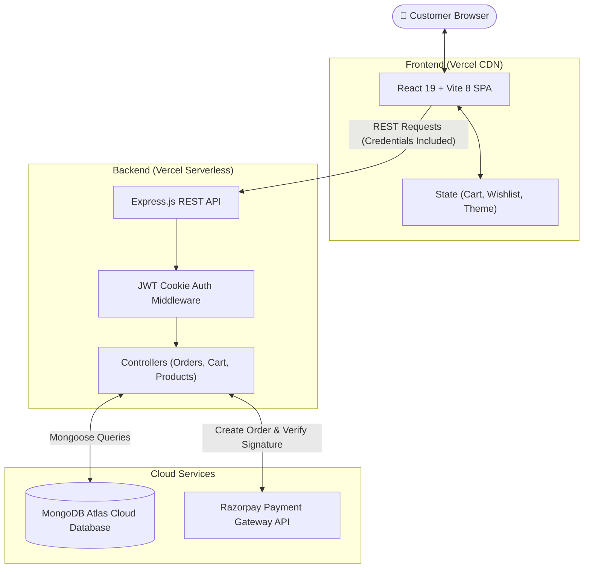
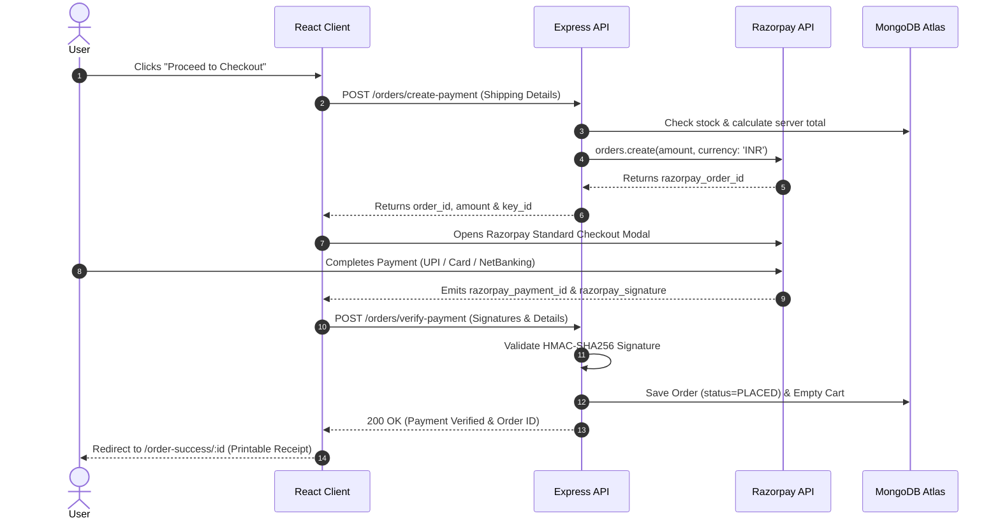

<div align="center">

# 🛒 Abracart — Modern Full-Stack MERN E-Commerce Platform

**An enterprise-grade, high-performance shopping application featuring real-time Wishlist synchronization, Razorpay payment gateway integration, and luxury Obsidian Dark/Light aesthetics.**

<br />

[](https://abracart.vercel.app)
[](https://abracart-backend.vercel.app/health)
[](LICENSE)

<br />

[](https://react.dev/)
[](https://vitejs.dev/)
[](https://tailwindcss.com/)
[](https://nodejs.org/)
[](https://expressjs.com/)
[](https://www.mongodb.com/)
[](https://razorpay.com/)

<br />

[Explore Live Demo](https://abracart.vercel.app) • [Key Features](#-key-features) • [System Architecture](#-system-architecture) • [Payment Workflow](#-payment-workflow) • [Setup Guide](#-local-setup-guide) • [API Documentation](#-api-reference)

---

</div>

## 🌟 Overview

**Abracart** is a full-featured, production-ready MERN stack e-commerce web application engineered for household essentials, electronics, fashion, and books. Built with a user-first philosophy, it brings desktop-class speed, modern glassmorphic micro-animations, end-to-end checkout with **Razorpay**, and zero-latency **Wishlist synchronization** across the entire UI.

### 🔗 Live Deployments
- **Frontend App**: [https://abracart.vercel.app](https://abracart.vercel.app)
- **Backend API**: [https://abracart-backend.vercel.app](https://abracart-backend.vercel.app)
- **Health Check**: [https://abracart-backend.vercel.app/health](https://abracart-backend.vercel.app/health)

---

## ⚡ Key Features

### 🛍️ Smart Product Catalog & Filtering
- **Multi-Category Filtering**: Instant toggle between `Electronics`, `Fashion`, `Books`, and `Home Essentials`.
- **Search & Price Sorting**: Real-time keyword search and dynamic price range adjustments.
- **Stock Scarcity Signals**: Amazon-inspired scarcity indicators (`In Stock`, `Only X left in stock`, `Out of Stock`) to drive buyer urgency.
- **Indian Rupee (₹) Formatting**: Standardized INR currency presentation with formatted comma separators.

### 💳 Razorpay Payment Gateway & Order Lifecycle
- **Server-Side Validation**: Product pricing and stock counts are re-verified on the server before initiating transactions.
- **Standard Razorpay Checkout**: Frictionless test payment modal supporting UPI, Cards, NetBanking, and Wallets.
- **HMAC-SHA256 Cryptographic Verification**: Eliminates spoofing by verifying web signatures before confirming orders.
- **Automatic Fulfillment**: Flushes cart contents, updates stock, generates order receipt snapshots, and transitions order status (`PLACED` ➔ `CONFIRMED` ➔ `SHIPPED` ➔ `DELIVERED`).

### 💖 Real-Time Synchronized Wishlist
- **Global Reactive State**: Powered by React Context; changes reflect immediately across Navbar badge counters, product cards, and the Wishlist page without manual page reloads.
- **Micro-Spring Feedback**: Heart burst bounce micro-animation upon saving or removing products.

### 🌙 Luxury Obsidian Dark / Light Theme
- Custom tailored color palettes using **Tailwind CSS v4** tokens.
- Deep Obsidian `#0B0F14` dark canvas with subtle glowing emerald borders and glassmorphism (`backdrop-blur-xl`).
- Theme state persists seamlessly in `localStorage` with automated system preference detection.

### 🔐 Secure Cross-Origin Authentication
- JWT-based authentication stored in cross-origin **`HttpOnly` cookies** (`SameSite=None`, `Secure=true`).
- Comprehensive protected routes preventing unauthorized access to checkout, orders, and profile pages.

---

## 🏗️ System Architecture



---

## 🔄 Payment Workflow



---

## 💻 Tech Stack

| Domain | Technology | Description |
| :--- | :--- | :--- |
| **Frontend Framework** | [React 19](https://react.dev/) | Modern concurrent React UI components |
| **Build Tool** | [Vite 8](https://vitejs.dev/) | Lightning fast Hot Module Replacement (HMR) |
| **Styling** | [Tailwind CSS v4](https://tailwindcss.com/) | Custom design tokens, glassmorphism, animations |
| **Routing** | [React Router v7](https://reactrouter.com/) | Declarative client-side routing & protected routes |
| **Backend Framework** | [Express.js](https://expressjs.com/) | RESTful API architecture running on Node.js |
| **Database** | [MongoDB Atlas](https://www.mongodb.com/atlas) | Cloud NoSQL database with Mongoose ORM |
| **Payment Gateway** | [Razorpay](https://razorpay.com/) | Secure checkout & HMAC-SHA256 signature verification |
| **Authentication** | [JWT](https://jwt.io/) & [Cookie-Parser](https://github.com/expressjs/cookie-parser) | Stateless session tokens via `HttpOnly` cookies |
| **Deployment** | [Vercel](https://vercel.com/) | Global edge network for frontend & serverless backend |

---

## 📁 Project Directory Structure

```text
abracart/
├── backend/
│   ├── config/
│   │   └── razorpay.js            # Razorpay SDK instance initialization
│   ├── controllers/
│   │   ├── cart.controller.js     # Cart sync, add, remove, quantity update
│   │   ├── customer.controller.js # Register, login, cookie handler, profile
│   │   ├── order.controller.js    # Razorpay order creation & signature verification
│   │   └── product.controller.js  # Product query, category filtering, search
│   ├── models/
│   │   ├── customer.model.js      # User schema with hashed passwords
│   │   ├── order.model.js         # Order schema with snapshot receipt items
│   │   └── product.model.js       # Product schema with inventory counts
│   ├── routes/
│   │   ├── cart.routes.js         # /cart routes
│   │   ├── customer.routes.js     # /customers & /wishlist routes
│   │   ├── order.routes.js        # /orders & payment routes
│   │   └── product.routes.js      # /products catalog routes
│   ├── seedProducts.js            # Database seeder script with sample inventory
│   ├── index.js                   # Express app entry, middleware & connection pool
│   ├── vercel.json                # Vercel serverless builder configuration
│   └── package.json
│
├── frontend/
│   ├── src/
│   │   ├── components/            # Navbar, ProductCard, CartItem, WishlistCard
│   │   ├── context/               # CartContext, WishlistContext, ThemeContext, ToastContext
│   │   ├── pages/                 # Home, Products, ProductDetails, Cart, Checkout, Orders, Receipts
│   │   ├── services/              # api.js (Axios wrapper with credentials)
│   │   ├── App.jsx                # Route definitions & provider tree
│   │   ├── index.css              # Tailwind v4 theme, animations & custom variants
│   │   └── main.jsx
│   ├── vercel.json                # SPA rewrite rules (prevents 404 on refresh)
│   ├── vite.config.js
│   └── package.json
│
└── README.md
```

---

## 🚀 Local Setup Guide

Follow these steps to run Abracart on your local machine:

### 1. Prerequisites
- **Node.js**: v18.0.0 or higher ([Download](https://nodejs.org/))
- **MongoDB**: Local MongoDB instance or free [MongoDB Atlas Cluster](https://www.mongodb.com/atlas)
- **Razorpay Account**: Free [Razorpay Dashboard](https://dashboard.razorpay.com/) for test API keys

---

### 2. Clone the Repository

```bash
git clone https://github.com/Rudra30507/abracart.git
cd abracart
```

---

### 3. Backend Setup

1. Open your terminal and navigate to `backend`:
   ```bash
   cd backend
   ```

2. Install dependencies:
   ```bash
   npm install
   ```

3. Create a `.env` file in the `backend` directory:
   ```env
   PORT=1001
   NODE_ENV=development
   MONGO_URI=your_mongodb_connection_string
   JWT_SECRET=your_jwt_secret_passphrase
   RAZORPAY_KEY_ID=your_razorpay_key_id
   RAZORPAY_KEY_SECRET=your_razorpay_key_secret
   CLIENT_URL=http://localhost:5173
   ```

4. Populate sample products into the database:
   ```bash
   npm run seed
   ```

5. Start the backend development server:
   ```bash
   npm run dev
   ```
   *Backend will run on [http://localhost:1001](http://localhost:1001)*

---

### 4. Frontend Setup

1. Open a **new terminal** window and navigate to `frontend`:
   ```bash
   cd frontend
   ```

2. Install dependencies:
   ```bash
   npm install
   ```

3. Create a `.env` file in `frontend`:
   ```env
   VITE_API_URL=http://localhost:1001
   ```

4. Start the frontend development server:
   ```bash
   npm run dev
   ```
   *Frontend will run on [http://localhost:5173](http://localhost:5173)*

---

## 📡 API Reference

### Health & Server Check
| Method | Endpoint | Description | Auth Required |
| :--- | :--- | :--- | :---: |
| `GET` | `/health` | Server uptime and health status | ❌ |

### Customer Authentication & Profile
| Method | Endpoint | Description | Auth Required |
| :--- | :--- | :--- | :---: |
| `POST` | `/customers/register` | Register a new customer account | ❌ |
| `POST` | `/customers/login` | Log in customer & set `HttpOnly` cookie | ❌ |
| `GET` | `/customers/me` | Fetch authenticated customer profile | ✅ |
| `POST` | `/customers/logout` | Clear customer session cookie | ✅ |

### Wishlist Management
| Method | Endpoint | Description | Auth Required |
| :--- | :--- | :--- | :---: |
| `GET` | `/customers/wishlist` | Retrieve customer's saved wishlist | ✅ |
| `POST` | `/customers/wishlist/:productId` | Toggle product in/out of wishlist | ✅ |
| `DELETE` | `/customers/wishlist/:productId` | Remove product from wishlist | ✅ |

### Product Catalog
| Method | Endpoint | Description | Auth Required |
| :--- | :--- | :--- | :---: |
| `GET` | `/products` | List products with search, filter, and pagination | ❌ |
| `GET` | `/products/:id` | Fetch detailed product information | ❌ |

### Shopping Cart
| Method | Endpoint | Description | Auth Required |
| :--- | :--- | :--- | :---: |
| `GET` | `/cart` | Get current customer's cart | ✅ |
| `POST` | `/cart` | Add product to cart | ✅ |
| `PATCH` | `/cart/:productId` | Update item quantity (bounded by available stock) | ✅ |
| `DELETE` | `/cart/:productId` | Remove item from cart | ✅ |

### Orders & Razorpay Checkout
| Method | Endpoint | Description | Auth Required |
| :--- | :--- | :--- | :---: |
| `POST` | `/orders/create-payment` | Validate stock & create Razorpay order | ✅ |
| `POST` | `/orders/verify-payment` | Verify HMAC-SHA256 signature & record order | ✅ |
| `GET` | `/orders` | Fetch full order history of customer | ✅ |
| `GET` | `/orders/:id` | Get printable order receipt snapshot | ✅ |
| `PATCH` | `/orders/:id/status` | Advance order status (`PLACED`, `CONFIRMED`, etc.) | ✅ |

---

## 👨‍💻 Author & Acknowledgements

Developed with ❤️ by **[Rudra Patel](https://github.com/Rudra30507)**

- **GitHub**: [@Rudra30507](https://github.com/Rudra30507)
- **Live Demo**: [abracart.vercel.app](https://abracart.vercel.app)

---

## 📄 License

This project is licensed under the [MIT License](LICENSE). Feel free to use, modify, and distribute it!

<div align="center">
  <sub>⭐ If you find Abracart helpful, don't forget to give it a star on GitHub! ⭐</sub>
</div>
